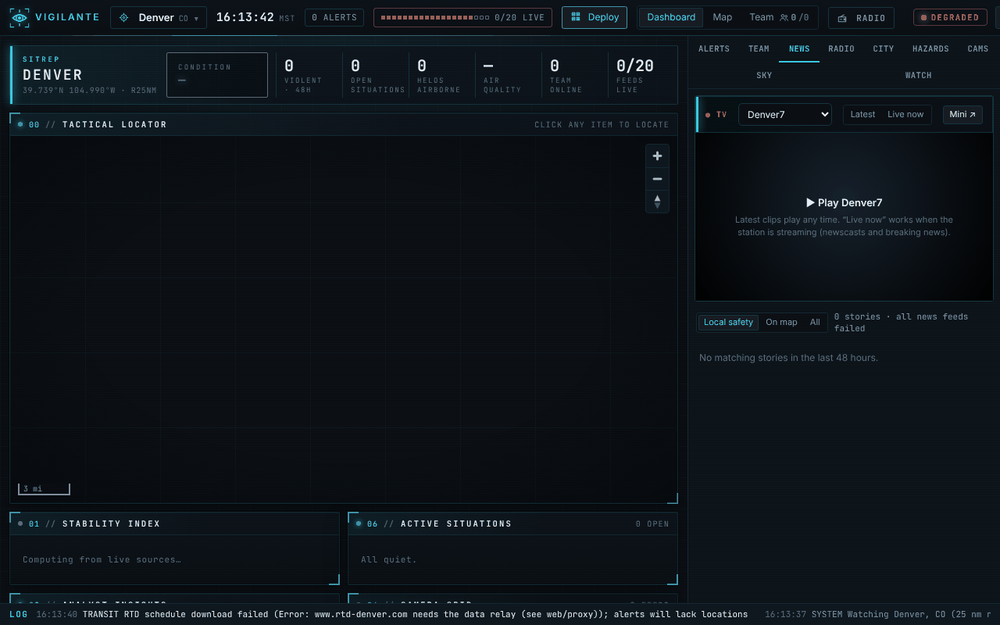
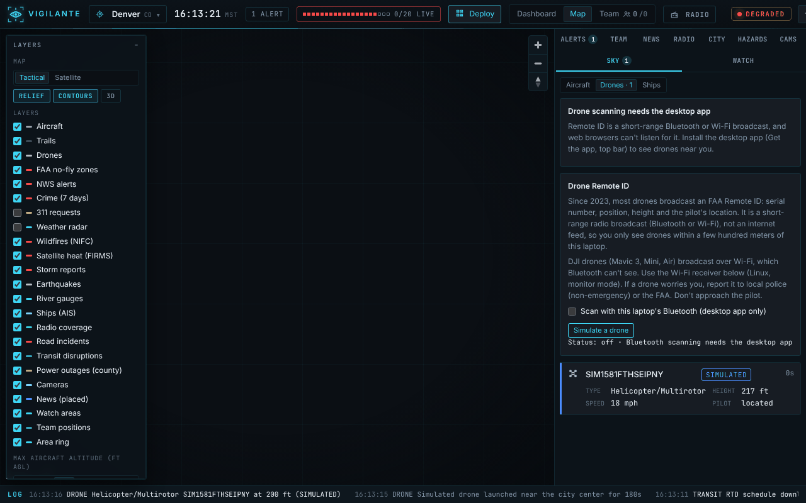
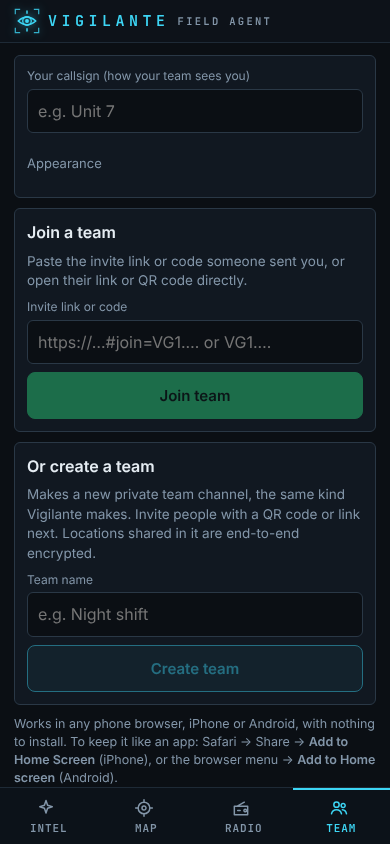

<p align="center"></p>

# Vigilante

**Part of the Vigilance Suite**: Vigilance (desktop), Vigilante (web and phone) and Vigil (Android).

**The live web app: [r0n1n9.github.io/vigilante](https://r0n1n9.github.io/vigilante/)**

A situational-awareness console that runs in any browser, and **Vigilante Field Agent**, its phone app for iPhone and Android with nothing to install. Built for people who keep watch over a place: physical security and asset protection teams, executive protection details, security patrol and neighborhood watch.

**The Vigilance Suite: three apps, one team.**

| App | What | Where |
|---|---|---|
| **Vigilante** (this repo) | Live web app and the Field Agent phone app | [r0n1n9.github.io/vigilante](https://r0n1n9.github.io/vigilante/) |
| **Vigilance** | Desktop app for Mac, Linux and Windows (adds drone Remote ID scanning, Meshtastic radios, multi-monitor pop-outs) | [R0N1N9/vigilance](https://github.com/R0N1N9/vigilance) |
| **Vigil** | Android app | [R0N1N9/vigil](https://github.com/R0N1N9/vigil) |

All three join the same teams: same invites and QR codes, same end-to-end encrypted team protocol ([`docs/TEAM_PROTOCOL.md`](docs/TEAM_PROTOCOL.md)). Vigilante and Vigilance share one codebase. This repo publishes the web build, which shows the Vigilante name; the desktop app lives in the Vigilance repo.

<p align="center">
  
  <br><sub>The console's dashboard for Denver: SITREP strip, tactical locator, stability index, active situations, and the News tab with the local TV player.</sub>
</p>

## Features

- **Live, keyless public data** for Denver, Atlanta or any US location: aircraft (ADS-B), FAA no-fly zones, NWS
  weather alerts and radar, crime and 311 open data, road incidents, transit disruptions, power outages, wildfires,
  satellite heat, earthquakes, river gauges, air quality, traffic cameras, local news and scanner radio.
- **Dashboard:** SITREP strip, Neighborhood Stability Index, tactical locator map, analyst insights, active
  situations, sector ratings, camera grid and local TV.
- **Map** with a Layers panel (tactical or satellite basemap, relief, contours, 3D) and a side rail of Alerts,
  Team, News, Radio, City, Hazards, Cams, Sky and Watch tabs.
- **Developing incidents, monitors and alerts:** signals that line up in place and time become incident cards;
  keyword, radius, aircraft and threshold monitors; phone alerts through ntfy.
- **Teams:** end-to-end encrypted team channels with chat, opt-in location sharing, marks, waypoints, photos and
  push-to-talk, joined by QR code from the **Deploy** button.
- **Field Agent** phone app in any browser, and an **embeddable** widget for other websites.

## Screenshots

| | |
|---|---|
|  |  |
| **Map view:** the Layers panel, and Sky → Drones with a simulated drone (real Remote ID scanning needs the desktop app). | **Field Agent** on a phone: join a team by invite or create one; Intel, Map, Radio and Team tabs. |

These were captured from a local build (`npm run build:web`, `npm run preview:web`) in a sandbox with no internet access, so the live feeds and map tiles are empty; on the live site the map and panels fill with live data.

## Field Agent (phones)

Open **[r0n1n9.github.io/vigilante/?view=field](https://r0n1n9.github.io/vigilante/?view=field)** on a phone, or scan a team's **Deploy** QR code from the console. Tabs:

- **Intel:** scans where you are: SITREP, active situations, alerts, news, hazards, city incidents, cameras and aircraft.
- **Map:** the live map with every layer and every teammate, mark, waypoint and photo. Press and hold for the ring menu: Ping, Mark, Recon, Waypoint, Backup, Photo, Go, Info, Zone, Radio.
- **Radio:** push-to-talk with the team, shared frequencies, scanner feeds for your area.
- **Team:** chat, opt-in encrypted location sharing, SOS and status codes, marks, recon requests, photos and invites.

**Add to Home Screen** (Safari → Share on iPhone; browser menu on Android) keeps it like an app. Keep it open and on screen to hear push-to-talk and get new photos: phones pause web pages in the background.

## Run it locally

Needs [Node.js 20+](https://nodejs.org/).

```bash
npm install
```

```bash
npm run dev:web
```

Then open http://localhost:5180 (the console) or http://localhost:5180/?view=field (Field Agent). The dev server includes the data relay at `/proxy`.

```bash
npm test
```

```bash
npm run build:web
```

## Project layout

```
packs/             City packs: center, radius, time zone, news feeds, TV channels, neighborhood gazetteer
config/hosts.json  Data hosts the app may fetch from (shared with the dev proxy and the web proxy)
src/lib/           Pure logic (unit-tested): ADS-B, NWS, TFRs, traffic, news, correlation, watch areas, alert rules, brief
src/data/          Store, cross-window sync bus, polling engine (one module per source)
src/map/           MapLibre map, icons, basemap styles
src/ui/            Command bar, panels, cards, the Field Agent app
web/               Web build: Vite config, index/embed pages, embed.js loader, security headers
web/proxy/         Cloudflare Worker CORS proxy for the web build (same host allowlist)
tests/             Vitest unit tests
```

Built with React 19, TypeScript, Vite and MapLibre GL.

## Web app and embedding

The same app also builds for the web, so it can run in a browser tab or be dropped into any website the way a live map widget is. It's the same `src/` code with its own Vite target in [`web/`](web/).

```bash
npm run dev:web       # http://localhost:5180 (uses the local /proxy)
npm run build:web     # -> dist-web/: index.html, embed.html, embed.js, _headers
npm run preview:web   # serve dist-web/ with the production security headers
```

### What's different on the web

| | Desktop app | Web app |
|---|---|---|
| Data sources | Rust core | The CORS proxy Worker in [`web/proxy/`](web/proxy/) (same host allowlist, GET only) |
| Settings, watch areas, saved places | Settings files | This browser's local storage |
| Phone alerts (ntfy) | Rust core | Straight from the browser (ntfy allows CORS) |
| Monitors and alert inbox | Settings files | This browser's local storage |
| Desktop notifications | OS notifications (Tauri plugin) | Browser notifications, after the visitor allows them |
| Team webhooks (Slack, Teams, Discord, JSON) | Rust core | Desktop only. Slack and Teams refuse posts from web pages, and the proxy stays GET-only rather than relaying to arbitrary URLs. |
| AI briefing, AIS ships | Optional key, kept in the core | Only with the visitor's own key, which stays in their browser; hidden otherwise |
| Drone Remote ID (Bluetooth/Wi-Fi) | Yes | No: browsers can't listen for it. The Drones tab says so. |
| Pop-outs | OS windows on any monitor | New browser tabs, kept in sync over BroadcastChannel |

AI briefings from the browser use Anthropic's `anthropic-dangerous-direct-browser-access` header with the visitor's own key and the same request as the desktop app. AISstream may refuse browser connections; the desktop app always works for ships.

### Deploy

1. **Proxy:** deploy the Cloudflare Worker: `cd web/proxy && npx wrangler deploy`. Details, origin locking and rate limits: [`web/proxy/README.md`](web/proxy/README.md).
2. **Site:** in GitHub, Settings → Pages → Source: *GitHub Actions*, and add an Actions variable `VITE_PROXY_URL` with the Worker URL. The [`Vigilante web app (GitHub Pages)`](.github/workflows/web.yml) workflow builds with the right base path (`/<repo>/`) and publishes on every push to `main`, or run it by hand.
3. Any static host works too: build with `VITE_BASE=/ VITE_PROXY_URL=https://... npm run build:web` and upload `dist-web/`. Cloudflare Pages and Netlify also apply `dist-web/_headers`.

No API keys are built into the bundle or stored in the repo.

### Embed it on a website

Paste one tag where the console should appear. It inserts a responsive, sandboxed `<iframe>`:

```html
<script src="https://r0n1n9.github.io/vigilante/embed.js" data-city="denver" data-view="dashboard" async></script>
```

| Attribute | Values | Default |
|---|---|---|
| `data-view` | `dashboard`, `map` | `dashboard` |
| `data-city` | `denver`, `atlanta`, or `lat,lon` (e.g. `39.7392,-104.9903`) | the visitor's last choice, else Denver |
| `data-theme` | `tactical`, `greenred`, `nightvision`, `amber`, `redlight`, `steel` | `tactical` |
| `data-height` | a CSS height: `640`, `640px`, `70vh` | `620px` |
| `data-target` | a CSS selector to fill instead of inserting after the tag | |

More examples:

```html
<!-- Map of Atlanta in amber -->
<script src="https://r0n1n9.github.io/vigilante/embed.js" data-city="atlanta" data-view="map" data-theme="amber" data-height="70vh" async></script>

<!-- Any US location -->
<script src="https://r0n1n9.github.io/vigilante/embed.js" data-city="40.0150,-105.2705" data-view="map" async></script>

<!-- Plain iframe, no script -->
<iframe src="https://r0n1n9.github.io/vigilante/embed.html?view=dashboard&city=denver&theme=nightvision"
        title="Vigilante" style="width:100%;height:620px;border:0" loading="lazy"
        sandbox="allow-scripts allow-same-origin allow-popups allow-popups-to-escape-sandbox"></iframe>
```

`embed.html` (or `?embed=1` on the main page) is the compact mode: slim top bar, no pop-outs, settings or window controls, and a footer strip linking to the full app. Replace `r0n1n9.github.io/vigilante` with your own deployment. The **Get the app** button (phone icon in the top bar) shows the embed snippet for the site you're on.

**Headers.** The app sends a Content-Security-Policy with `frame-ancestors *` so any site can embed it ([`web/headers.ts`](web/headers.ts); written to `_headers` for Cloudflare Pages and Netlify, and sent by `preview:web`). GitHub Pages can't set headers, but it sends no `X-Frame-Options`, so embedding works there too, and the rest of the policy ships as a `<meta>` tag. The embed sets no cookies, has no logins and tracks no one.

### Get the app

The **Get the app** dialog (phone icon in the top bar, or the embed footer) links the full project on GitHub and the Android app, with QR codes drawn in the browser (the pinned `qrcode` package, no external QR service). The Android link lives in one constant, `MOBILE_APP` in [`src/lib/links.ts`](src/lib/links.ts); point it at the Play Store listing when that's live.

